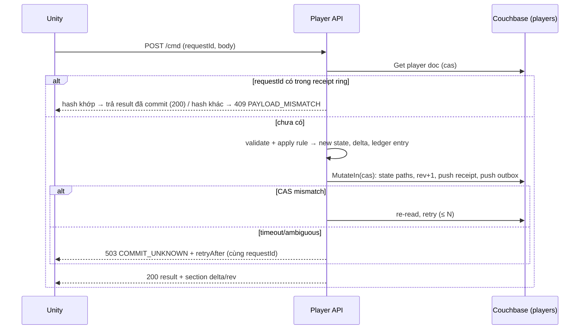

# Đánh giá độ phù hợp kỹ thuật — System Requirements v1.0 (Modular Game Server Framework)

| Thuộc tính | Giá trị |
| --- | --- |
| Tài liệu được review | `D:\MyProjects\AI\framework\game-server-dotnet-kestrel\Game_Server_System_Requirements.md` (v1.0, grooming draft, 21/10/2026) |
| Vai trò review | Kiến trúc sư hệ thống backend game |
| Ngày review | 21/10/2026 |
| Bối cảnh | Thay thế/chuẩn hoá nền tảng PlayFab + Azure Functions .NET 8 (Sniper PVP) bằng framework dùng chung; chưa có code |
| Phạm vi | Độ phù hợp kỹ thuật của 12 nhóm lựa chọn/yêu cầu; không viết code, không tạo project |

Quy ước nhãn trong báo cáo:

- **[REQ]** — đề xuất thay đổi/bổ sung *nội dung yêu cầu* (phải sửa tài liệu).
- **[IMPL]** — hướng dẫn triển khai; yêu cầu giữ nguyên, chỉ bổ sung vào design doc/ADR.
- **[VERIFY]** — fact phiên bản/khả năng thư viện tôi không chắc 100%; phải xác minh trước khi khoá baseline. Danh mục tổng hợp ở mục 15.

---

## 0. Tóm tắt điều hành

Tài liệu đặt đúng các yêu cầu *bản chất* (authoritative, idempotency, CAS, durability, security profile bắt buộc, capacity contract có TBD rõ ràng). Điểm yếu chính không nằm ở lựa chọn công nghệ mà ở chỗ tài liệu **chưa chốt mô hình dữ liệu nền tảng** (player state là một aggregate document hay nhiều document) — quyết định này kéo theo gần như toàn bộ các nhóm 2, 3, 4, 6, 8. Nếu chọn sai (nhiều document + Couchbase distributed transaction trên hot path), chi phí vận hành và độ phức tạp tăng mạnh mà không có lợi ích tương ứng với mô hình HTTP request-response không realtime.

Khuyến nghị kiến trúc xuyên suốt của báo cáo này: **"aggregate document per player + embedded receipt ring + embedded outbox, ghi bằng một CAS/sub-document mutation duy nhất"**. Distributed transaction là công cụ dự phòng được công bố cho các thao tác hiếm, không phải cơ chế mặc định.

### Điểm phù hợp theo nhóm (1 = không phù hợp, 5 = phù hợp, chỉ cần tinh chỉnh nhỏ)

| # | Nhóm | Điểm | Nhận xét ngắn |
| --- | --- | --- | --- |
| 1 | Stack (.NET 10, Kestrel, Controllers, Protobuf) | 4 | Đúng hướng; cần chốt Minimal API thay Controllers/Application Parts và chi tiết Protobuf/IL2CPP |
| 2 | Couchbase cho mô hình này | 3 | Phù hợp nếu gom aggregate; tài liệu đang để ngỏ và ngầm dựa vào transaction đa document |
| 3 | Idempotency & receipt | 4 | Yêu cầu đúng; thiếu mô hình cụ thể; "mâu thuẫn TTL vs vĩnh viễn" giải quyết được bằng tách receipt/state |
| 4 | Revision/snapshot/delta | 3 | Chỉ nói "không global revision"; chưa có mô hình để client resync |
| 5 | Identity | 4 | Yêu cầu đầy đủ; cần chốt dạng session token và cơ chế guest credential |
| 6 | Security GM | 4 | Rất tốt; cần cơ chế thực thi SEC-08 và mô hình permission/scope cụ thể |
| 7 | Module system | 3 | 4 project/module quá nặng cho P0; thiếu IModule contract; ARC-08 quá chung |
| 8 | Jobs/outbox | 4 | Lease + outbox trên Couchbase đủ cho P1; cần nêu rõ điều kiện cần broker |
| 9 | Perf & load-shedding | 4 | Làm được bằng middleware built-in; cần nói rõ giới hạn là per-instance |
| 10 | Observability/logging | 3 | Serilog rolling đáp ứng; thiếu OpenTelemetry và cách phát hiện lỗi storage của log |
| 11 | Những thứ còn thiếu | 2 | Thiếu IAP, remote config, Unity SDK, maintenance/version gate, ban, migration từ PlayFab, test harness, CI |
| 12 | Leaderboard → League | 3 | Couchbase làm được với mẫu phù hợp; tài liệu chưa nêu mẫu và giới hạn; Redis không bắt buộc |

### Top 8 rủi ro kỹ thuật

| # | Rủi ro | Liên quan |
| --- | --- | --- |
| R1 | Dùng Couchbase distributed transaction trên hot path gameplay (nhiều document/command) → latency ×3–5, retry do conflict, `CommitAmbiguous` khó xử lý | ECO-04, DAT-04, CMD-03 |
| R2 | Receipt tách document và ghi không nguyên tử với state → ACC-04/ACC-07 không đạt khi DB timeout giữa hai write | CMD-03, CMD-04 |
| R3 | Giftcode quota dùng CAS/transaction trên một document nóng → burst (code streamer) gây retry storm | GFT-04, TBD-07 |
| R4 | Protobuf trên Unity IL2CPP: stripping xoá descriptor/reflection, lệch version protoc vs runtime, xung đột `System.Memory` | API-09, ACC-18 |
| R5 | SEC-08 chỉ là "yêu cầu" không có cơ chế thực thi → endpoint mới mở ngầm (ACC-12 fail) | SEC-08, SEC-09 |
| R6 | 4 project × 6 module ≈ 30 project ngay P0 → build chậm, ma sát, team bỏ qua ranh giới | 4.2, ARC-01 |
| R7 | Thiếu IAP validation, maintenance/version gate, remote config → Sniper PVP không thể migrate khỏi PlayFab với scope P0 hiện tại | Mục 11 báo cáo |
| R8 | Không có OpenTelemetry/correlation request→DB → OBS-02 không kiểm chứng được; debugging sự cố "commit không rõ" rất khó | OBS-01, OBS-02, CMD-04 |

### Top 8 đề xuất thay đổi

1. **[REQ]** Thêm DAT-09: player state (profile/progression/resource) là **một aggregate document** có `rev`, receipt ring và outbox nhúng; command gameplay thường = 1 CAS/sub-doc mutation; transaction chỉ cho thao tác được công bố.
2. **[REQ]** Sửa 2.2/API adapter: **Minimal API + endpoint group + đăng ký tường minh qua `IModule`**, không dùng Controllers + Application Parts auto-discovery (xung đột ARC-07).
3. **[REQ]** Sửa CMD-03/CMD-07: tách rõ "receipt = dedupe retry, có window" và "business invariant = state bền vững"; công bố window mặc định (ring 64 entry + 24h).
4. **[REQ]** Thêm API-10: mô hình revision **per-section** (`section`, `rev`), snapshot = tập section; client áp delta khi `baseRev` khớp, ngược lại refetch section.
5. **[REQ]** Sửa GFT-04: quota dùng **atomic counter reserve-then-confirm**; chấp nhận under-fill khi crash, không bao giờ over-sell.
6. **[REQ]** Sửa SEC-08: nêu cơ chế thực thi bắt buộc — fallback policy deny-by-default + startup validator trên `EndpointDataSource` + architecture test trong CI.
7. **[REQ]** Sửa 4.2: cấu trúc module **2 project** (`Module` = Application; `Module.Adapters` = Infrastructure + Api) + `Module.Contracts` khi có consumer; 4 project là tuỳ chọn.
8. **[REQ]** Thêm các nhóm yêu cầu mới: OBS-04 (OpenTelemetry), CFG (remote/game config), SDK (Unity client SDK), GATE (maintenance/version gate), IAP, BAN, PRIV, TST/CI, MIG (migration từ PlayFab).

---

## 1. Stack: .NET 10 LTS, Kestrel, Controllers vs Minimal API, Protobuf không gRPC

### 1.1 .NET 10 LTS

- **Phù hợp.** .NET 10 phát hành 11/2025, là bản LTS (các bản chẵn là LTS kể từ .NET 6), hỗ trợ 3 năm → khoảng 11/2028. .NET 8 LTS hết hỗ trợ ~11/2026, .NET 9 là STS — nhảy thẳng từ .NET 8 (Azure Functions hiện tại) lên .NET 10 là lựa chọn đúng, tránh phải nâng cấp hai lần. **[VERIFY]** ngày EOL chính xác của .NET 10 và .NET 8 trên trang lifecycle của Microsoft trước khi ghi vào baseline.
- **Rủi ro tương thích:**
  - Couchbase .NET SDK 3.x target `net8.0`/`netstandard2.0` (không có TFM `net10.0` riêng, **[VERIFY]** với phiên bản SDK sẽ khoá). Chạy trên .NET 10 qua TFM thấp hơn là bình thường, nhưng: (a) không được bật Native AOT/trimming cho host (SDK dùng reflection và serializer động); (b) kiểm tra SDK có hỗ trợ `System.Text.Json` serializer thay cho Newtonsoft mặc định hay không — ảnh hưởng document mapping và hiệu năng.
  - Serilog và các sink target `netstandard2.0` → không vấn đề.
  - Rủi ro thật nằm ở **Couchbase Server version** tương thích với SDK (transactions yêu cầu Server 7.x; scope/collection yêu cầu 7.0+). Tài liệu chỉ nói "được kiểm tra tương thích" — cần ghi phiên bản tối thiểu.
- **Đề xuất [REQ]** bổ sung vào 2.2: "Couchbase Server ≥ 7.6 (**[VERIFY]**), Couchbase .NET SDK 3.x (phiên bản khoá tại thời điểm triển khai), host không bật Native AOT; ma trận tương thích SDK/Server chạy trong CI".

### 1.2 Kestrel

- **Phù hợp.** Lưu ý vận hành: Kestrel thường chạy sau load balancer/reverse proxy (TLS termination). Phải cấu hình `ForwardedHeaders` giới hạn trusted proxy để rate-limit theo IP và audit IP không bị giả mạo. **[IMPL]** bổ sung vào OPS-02.

### 1.3 Controllers + Application Parts vs Minimal API / endpoint groups

| Tiêu chí | Controllers + Application Parts | Minimal API + endpoint groups |
| --- | --- | --- |
| ARC-07 "đăng ký tường minh" | Application Parts là **auto-discovery** theo assembly — đi ngược yêu cầu | Module gọi `MapEndpoints(RouteGroupBuilder)` tường minh |
| SEC-08 metadata bắt buộc | Thực thi được qua `IApplicationModelConvention` | Thực thi qua `WithMetadata` + extension `.RequirePlayer()/.RequireGm(perm)` |
| ARC-04 tách đăng ký service khỏi expose API | Phải lọc controller bằng `IApplicationFeatureProvider` — phức tạp | Tự nhiên: `IModule.ConfigureServices` tách khỏi `IPlayerApi.Map`/`IGmApi.Map` |
| Protobuf binding | `InputFormatter`/`OutputFormatter` — chuẩn nhưng đi qua model binding/filters của MVC | Wrapper `ProtoBody<T>` với `static BindAsync(HttpContext)` + `IResult` tuỳ biến — ít tầng hơn |
| Validation JSON (GM) | DataAnnotations có sẵn | .NET 10 có validation built-in cho Minimal API (**[VERIFY]**); hoặc FluentValidation qua endpoint filter |
| Overhead per request | Cao hơn (MVC pipeline) | Thấp hơn |
| Kinh nghiệm team | Team đến từ Azure Functions (không phải MVC) — không có lợi thế sẵn | Gần với mô hình Function/handler hơn |

- **Khuyến nghị [REQ]:** đổi dòng "API adapter" trong 2.2 thành **"Minimal API; mỗi module map endpoint tường minh qua `IModule`; Controllers chỉ dùng nếu có lý do ghi lại, và khi đó phải `AddApplicationPart` tường minh từng assembly + convention kiểm tra metadata"**. Lý do chính: ARC-07 và ARC-04 gần như miễn phí với Minimal API, còn Application Parts bản chất là discovery ngầm.
- Cập nhật mục 18: bỏ hoặc hạ cấp link Application Parts; thêm link Minimal API route groups và custom binding.

### 1.4 Protobuf không gRPC — bind `application/x-protobuf`

**[IMPL]** Hướng dẫn triển khai (yêu cầu API-01 giữ nguyên):

- ASP.NET Core **không** có formatter sẵn cho `application/x-protobuf`; phải tự viết. Với Minimal API: `ProtoBody<T> where T : IMessage<T>, new()` có `BindAsync`; đọc body qua `PipeReader`, kiểm tra `Content-Type` (sai → 415 theo API-05), kiểm tra `Content-Length`/đếm byte trước khi parse (413), parse bằng `MessageParser<T>` với `CodedInputStream` có `SizeLimit`/`RecursionLimit`. Output: `ProtoResult(IMessage)` ghi `application/x-protobuf`.
- **Error response cũng phải là Protobuf** trên player route (một `ErrorEnvelope` message dùng chung), kể cả 4xx/5xx do middleware (rate limiter, auth) sinh ra — nếu không Unity phải xử lý hai định dạng. **[REQ]** bổ sung vào API-04: "Player endpoint trả lỗi bằng `ErrorEnvelope` Protobuf; GM endpoint trả Problem Details JSON".
- Nén: nếu bật request/response compression phải giới hạn **decompressed size** (API-06 đã nêu) — Request Decompression middleware của ASP.NET Core áp dụng `MaxRequestBodySize` lên kích thước sau giải nén (**[VERIFY]** hành vi với phiên bản 10).

### 1.5 Tương thích Unity IL2CPP (API-09)

| Lựa chọn | Đánh giá |
| --- | --- |
| **Google.Protobuf (C# chính thức, protoc)** | **Khuyến nghị.** Cùng `.proto` là nguồn sự thật duy nhất cho server và client (khớp API-03). Generated code dùng reflection rất ít (descriptor static ctor, `MessageParser`); chạy tốt trên IL2CPP. Cần `link.xml` preserve `Google.Protobuf` và assembly chứa generated code khi Managed Stripping Level = Medium/High. Phụ thuộc `System.Memory`, `System.Buffers`, `System.Runtime.CompilerServices.Unsafe` với build `netstandard2.0` — có thể xung đột với BCL của Unity (.NET Standard 2.1 profile) tuỳ phiên bản Unity (**[VERIFY]** với phiên bản Unity của Sniper PVP). Generated code yêu cầu runtime Google.Protobuf ≥ phiên bản protoc đã dùng → phải **pin cùng một version** ở server và client. |
| protobuf-net | **Không khuyến nghị.** Contract theo attribute C#, không có `.proto` làm nguồn sự thật → vi phạm tinh thần API-03; trên IL2CPP cần precompile serializer (`RuntimeTypeModel.Compile`) — thêm bước build và rủi ro. |

- **[REQ]** bổ sung API-09: "Generated code và runtime Protobuf dùng cùng một phiên bản được pin; client SDK đóng gói `link.xml`; CI có bước build Unity IL2CPP smoke (Android) để phát hiện stripping sớm" — thay vì chỉ "kiểm tra trên target thực tế" ở nghiệm thu.
- **[IMPL]** Unity dùng `UnityWebRequest` với raw bytes; không có HTTP/2 — không ảnh hưởng. Bật `deterministic serialization` phía client không cần thiết nếu client cache bytes đã gửi để retry (xem mục 3.3).

---

## 2. Couchbase cho mô hình này

### 2.1 CAS / optimistic concurrency (CMD-05)

- **Phù hợp.** CAS của Couchbase KV là per-document, hoạt động xuyên instance → đáp ứng CMD-05 (Player API, GM API, job trên nhiều instance). Mẫu: `Get` → tính toán → `Replace(cas)` hoặc `MutateIn(cas)`; `CasMismatchException` → đọc lại và thử lại có giới hạn (3–5 lần, jitter) rồi trả 409.
- **Rủi ro:** CAS chỉ bảo vệ khi **mọi** writer dùng nó. Bất kỳ `Upsert` không CAS trên player document (GM tool "sửa nhanh", script migration) đều phá vỡ. **[REQ]** bổ sung CMD-05: "Repository của aggregate chỉ expose thao tác ghi có CAS; không có API `Upsert` không điều kiện cho document nghiệp vụ".
- **[IMPL]** Sub-document `MutateIn` nhận CAS và áp dụng nhiều path trong **một** thao tác nguyên tử (giới hạn ~16 ops/command, **[VERIFY]**) → có thể ghi `rev`, phần state thay đổi, receipt ring entry và outbox entry trong 1 round trip mà không rewrite toàn bộ document.

### 2.2 Distributed ACID transactions (ECO-04, DAT-04) — chi phí và giới hạn

| Khía cạnh | Thực tế |
| --- | --- |
| Chi phí | Mỗi transaction: ghi ATR (Active Transaction Record) + staged write (xattr) cho từng document + commit + unstage + cleanup ≈ 3–5 KV round trip/document, bắt buộc durability ≥ Majority. Latency điển hình hàng chục ms thay vì ~1 ms cho một KV op. |
| Conflict | Write-write conflict trên cùng document → `TransactionFailed` + retry nội bộ; dưới burst trên hot document → retry storm. |
| Ambiguity | `TransactionCommitAmbiguousException` xảy ra thật khi mất kết nối lúc commit — phải có cơ chế tra cứu kết quả (chính là CMD-04). |
| Ràng buộc | Yêu cầu Server 7.x, có Majority durability (tức cần replica và ≥2 node trong production; dev single-node phải cấu hình riêng — **[VERIFY]** hành vi Majority với 0 replica). Timeout mặc định 15 s. Không được trộn write không transaction trên cùng document đang trong transaction (sẽ gây conflict). |

- **Đánh giá:** tài liệu viết "nếu nhiều document/module tham gia, phải có transaction boundary hoặc durable workflow" — đúng nhưng **chưa nói khi nào nên tránh để nhiều document tham gia**. Với mô hình HTTP request-response, command gameplay thường (hoàn thành màn, nâng cấp, nhận thưởng) chạm đúng một player → **gom vào một aggregate document** là lựa chọn mặc định đúng.
- **Khuyến nghị [REQ] — thêm DAT-09:** "Player state chính thức (profile, progression, resource/wallet, inventory) được lưu trong **một aggregate document** per player (`players` collection), có `rev` đơn điệu, **receipt ring** và **outbox** nhúng. Command gameplay chỉ chạm một aggregate phải commit bằng **một** CAS/sub-document mutation, không dùng transaction. Transaction hoặc durable workflow chỉ dùng cho thao tác được liệt kê (GM cross-aggregate, event close, season rollover) và phải xử lý `CommitAmbiguous` bằng receipt lookup." Kèm **ngân sách kích thước**: cảnh báo ở 128 KiB, giới hạn cứng 256 KiB (Couchbase cho phép 20 MB, nhưng rewrite/replication/network tăng tuyến tính; Sniper PVP state hiện tại cần đo để chốt số — TBD).
- **Trade-off được chấp nhận:** nhiều command đồng thời của *cùng một* player cạnh tranh CAS trên cùng document — đúng với CMD-06 (ordering per player); các player khác nhau hoàn toàn độc lập.

### 2.3 Hot key quota giftcode (GFT-04, TBD-07)

| Mẫu | Mô tả | Đánh giá |
| --- | --- | --- |
| A. **Atomic counter reserve-then-confirm** | `quota::{code}` dùng sub-document/binary `Increment(1)` (atomic server-side, không CAS). `n > quota` → `Decrement(1)` + reject "hết lượt". Thành công → tiếp tục claim; nếu claim thất bại → `Decrement(1)` (compensation, best-effort). | **Khuyến nghị.** Counter op ~sub-ms, một key chịu được hàng nghìn–chục nghìn op/s trên một node — vượt xa burst giftcode thực tế. Fail-safe về hướng **không bao giờ over-sell**; crash giữa chừng chỉ gây under-fill (mất vài suất) — chấp nhận được và nên ghi vào yêu cầu. |
| B. Sharded counter | N shard × quota/N | Chỉ khi A không đủ; sinh vấn đề "hết ở shard này còn ở shard kia". **Defer.** |
| C. Transaction gồm quota doc | Counter trong transaction cùng player doc | **Từ chối** cho code nóng: contention → retry storm. Chỉ chấp nhận cho code quota nhỏ/riêng tư nếu muốn exactly-once tuyệt đối. |

- **Once-per-player** (không vượt giới hạn nhận theo player): key insert-only `gclaim::{code}::{playerId}` trong collection `giftcode_claims` — `Insert` thất bại nếu đã tồn tại → atomic xuyên instance, không cần transaction. Thứ tự: (1) insert claim marker `pending` → (2) reserve counter → (3) CAS apply reward + receipt vào player doc → (4) marker `completed` (hoặc suy ra từ receipt). Retry cùng requestId: tìm receipt trong player doc trước; nếu marker `pending` quá hạn và không có receipt → reaper hoàn trả counter. Đây là một saga 3 bước nhỏ, phải được mô tả trong design doc Giftcode.
- **[REQ]** sửa GFT-04: thêm "Quota dùng atomic counter reserve-then-confirm; hệ thống bảo đảm không vượt quota; chấp nhận quota không được dùng hết trong trường hợp lỗi giữa chừng; once-per-player bảo đảm bằng insert-only claim key". Đóng TBD-07 phần hot-key.

### 2.4 Durability level (DAT-05, ECO-05)

**[REQ]** công bố bảng durability mặc định (hiện DAT-05 chỉ nói "phải được công bố"):

| Loại dữ liệu | Durability ghi | Read |
| --- | --- | --- |
| Player aggregate, identity mapping, giftcode claim, receipt độc lập, ledger, GM audit, staff/permission | `Majority` (cân nhắc `MajorityAndPersistToActive` cho ledger/audit nếu đo được chi phí) | Active, không stale |
| Session | `Majority` (rẻ, tránh mất session khi failover) | Active |
| Leaderboard score / materialized rank | `None` hoặc `Majority` tuỳ board | Chấp nhận stale theo LDB-01 |
| Lease/outbox/progress | `Majority` | Active |

Dev single-node phải có cấu hình riêng (replica = 0) để `Majority` không fail; ghi rõ trong OPS-01.

### 2.5 N1QL index vs KV lookup (PERF-07)

- KV: sub-ms, strongly consistent trên active. N1QL: cần Index Service, **index là eventually consistent** (mặc định `NotBounded`); `RequestPlus` chờ index bắt kịp → tăng latency; query planner, memory quota riêng.
- **[REQ]** siết PERF-07 thành MUST: "Hot path gameplay (login, command, snapshot) chỉ dùng KV (get/mutateIn/insert/counter) với key xác định; N1QL chỉ cho GM search/list, báo cáo, job và materialize leaderboard; mỗi N1QL phải khai báo `scan_consistency`, có covering index được module provisioning, và không `SELECT *` trên collection player."

### 2.6 TTL (DAT-03, CMD-07)

- Phù hợp cho `sessions` (expiry + `Touch` để sliding) và `receipts` độc lập. Với receipt **nhúng** trong player doc thì bounded theo số entry, không cần TTL. Ledger/audit/claim marker: không TTL (đúng DAT-03). **[VERIFY]** cách SDK biểu diễn expiry > 30 ngày (Couchbase coi giá trị > 30 ngày là Unix timestamp tuyệt đối; SDK thường xử lý, nhưng cần test). Collection-level `maxTTL` là lưới an toàn để receipt/session không bao giờ "quên" TTL.

### 2.7 Scope/collection per game/environment (DAT-01) — có nên tách receipt/ledger?

- **Có.** Khuyến nghị:
  - **Environment = cluster riêng** cho Production; Dev/Staging có thể chung cluster nhưng **bucket riêng**. Không trộn env trong cùng bucket (blast radius, backup, RBAC).
  - **Game = scope** (`g_<gameId>`), mỗi module sở hữu các **collection** của mình: `players`, `identities`, `sessions`, `receipts`, `ledger`, `giftcodes`, `giftcode_claims`, `gm_audit`, `gm_staff`, `outbox`, `leases`, (P1) `events`, `boards`, `scores`.
  - Lợi ích: RBAC theo scope/collection (DAT-07 least privilege — **[VERIFY]** mức granular của Couchbase RBAC với phiên bản dùng), index nhỏ theo collection, `maxTTL` per collection, backup/restore chọn lọc (DAT-08: ledger/receipt cùng player), key không cần prefix game/env (nhưng document vẫn giữ `gameId`/`env` làm defense-in-depth).
  - Receipt/ledger/audit **tách collection** vì khác hẳn profile: append-only, TTL khác nhau, index khác, retention khác (TBD-08).
- **[REQ]** sửa DAT-01: thay "khoá dữ liệu phải phân biệt game/environment khi có thể va chạm" bằng quy ước cụ thể trên.

---

## 3. Idempotency & receipt (API-07, CMD-01..07, ECO-05)

### 3.1 Hai tầng receipt

| Tầng | Dùng cho | Cơ chế | Atomic với state? |
| --- | --- | --- | --- |
| **A — Receipt ring nhúng trong aggregate** | Command của player chạm một aggregate (đa số command gameplay, GM adjust một player) | Mảng bounded (đề xuất 64 entry, FIFO) trong player doc: `{requestId, op, bodyHash, resultCode, resultPayload (compact), committedAt, rev}` | **Có** — cùng một CAS/mutateIn với state → thoả CMD-03 tuyệt đối, không cần transaction |
| **B — Receipt document độc lập** | Command cross-aggregate, job, GM batch | `receipts` collection, key `rcpt::{actorScope}::{op}::{requestId}`; `Insert` (atomic, fail nếu tồn tại) state `Pending` + `bodyHash` → thực thi (transaction/saga) → cập nhật `Committed` + result **trong cùng transaction** | Có nếu nằm trong transaction; nếu không, `Pending` quá hạn phải có reaper |

Luồng tầng A:



Điểm quan trọng: **CMD-04 chỉ thực hiện được sạch với tầng A** — khi KV timeout, server không biết write đã áp dụng chưa; client retry cùng requestId, server đọc lại doc: receipt có → trả kết quả cũ; không có → thực hiện. Với receipt tách document (không transaction) sẽ có cửa sổ "state ghi rồi, receipt chưa ghi" → double effect.

### 3.2 Idempotency key và hash (CMD-01, CMD-02)

- Key: `(gameId, env, actorId, operation, requestId)` — env/game đã là scope/collection; trong doc chỉ cần `(operation, requestId)` per actor. Đúng với CMD-01.
- Hash: SHA-256 trên **raw request body bytes** như nhận được (không re-serialize). Protobuf không canonical giữa các implementation, nhưng cùng client cùng bytes là ổn định. **Ràng buộc client SDK:** khi retry phải gửi lại **đúng bytes đã cache**, không build lại message (xem SDK-02 mục 11).
- Cùng key khác hash → 409 với code `IDEMPOTENCY_PAYLOAD_MISMATCH`, không retry (ACC-05). Cùng key đang `Pending` (tầng B) → 409 `COMMAND_IN_PROGRESS` + `retryAfter`.

### 3.3 Replay window vs invariant vĩnh viễn (CMD-07) — có mâu thuẫn không?

**Không mâu thuẫn nếu tách đúng hai khái niệm:**

- *Receipt* trả lời "request này đã được xử lý chưa, kết quả là gì" — chỉ cần sống qua horizon retry của client (phút → vài ngày). Window đề xuất: ring 64 entry **và** receipt độc lập TTL 24–72 h; publish con số nhỏ hơn.
- *Invariant nghiệp vụ* ("nhận giftcode một lần", "battle này đã trả thưởng") là **state** có chủ sở hữu, không hết hạn: claim marker (mục 2.3), `battle::{battleId}` document do server cấp khi bắt đầu trận với trạng thái `rewarded`, cờ `claimedRewards[]` trong progression.
- Khi receipt đã hết hạn và client gửi lại cùng requestId: command đi qua validation nghiệp vụ → invariant từ chối (ví dụ `ALREADY_CLAIMED`) — đúng, không phải lỗi, vì ý nghĩa nghiệp vụ được bảo toàn; chỉ khác là client không nhận lại *receipt cũ* mà nhận lỗi nghiệp vụ. Phải ghi rõ hành vi này.
- **[REQ]** sửa CMD-07: "Receipt bảo đảm *cùng kết quả* trong window đã công bố (mặc định: 64 command gần nhất per player hoặc 24 h, lấy giá trị nhỏ hơn). Ngoài window, retry được xử lý như request mới và bị từ chối bởi invariant nghiệp vụ nếu đã thực hiện. Mọi hiệu ứng 'một lần' phải có state bền vững riêng, không dựa vào receipt."
- `battleId` do server cấp (endpoint `StartBattle`) là cách rẻ nhất để biến "evidence" thành state có chủ (TBD-02); battle document có TTL theo business window (ví dụ 7 ngày) — vì trận quá cũ không hợp lệ dù có hay không receipt.

### 3.4 Ledger (ECO-06) trong cùng commit

Ledger entry là append-only document riêng → ghi nguyên tử với state bằng cách **đưa entry vào outbox nhúng** trong cùng mutation (mục 8), drainer chuyển sang collection `ledger` với key = `entryId` (idempotent, at-least-once). Ledger "chính thức" tồn tại ngay tại thời điểm commit (trong doc), bản sao trong collection `ledger` là projection cho tra cứu/GM. Ghi rõ trong ECO-06 để không ai hiểu là phải transaction 2 document.

---

## 4. Revision / snapshot / delta (API-08, IDN-07, PLY-02, mục 12)

### 4.1 Lựa chọn mô hình

| Mô hình | Đánh giá |
| --- | --- |
| Global revision cho toàn bộ player | Cần atomicity xuyên document/module → tài liệu đã đúng khi bác bỏ |
| Version vector đầy đủ (mọi aggregate × mọi module) | Overkill cho P0; client Unity khó xử lý |
| **Per-section revision** | **Khuyến nghị.** Mỗi *section* (= một aggregate hoặc một phần đã công bố của aggregate) có `rev` đơn điệu (long) tăng mỗi commit; `rev` lưu trong document, **không dùng Couchbase CAS làm revision public** (CAS là opaque 64-bit, thay đổi theo mutation nội bộ như touch/xattr, không đơn điệu theo nghĩa nghiệp vụ). |

- P0 với một aggregate per player: thực tế chỉ có 1–2 section (`player`, có thể thêm `giftcode`/`event` sau). Mô hình per-section cho phép thêm module mà không đổi contract client.
- Snapshot (IDN-07/PLY-02) = `repeated Section { string id; uint64 rev; bytes payload; }` hoặc oneof typed per module. Khuyến nghị `bytes payload` + `id` thay vì `google.protobuf.Any` để giảm phụ thuộc reflection/type registry trên IL2CPP (**[IMPL]**).
- Response command (API-08): `repeated SectionUpdate { id; uint64 baseRev; uint64 newRev; bytes payload; bool full; }`. P0 khuyến nghị **`full = true` (thay toàn bộ section)** — section đủ nhỏ, loại bỏ hoàn toàn bài toán delta-merge ở client; field-level delta chỉ làm khi đo thấy payload lớn.
- Quy tắc client: áp dụng nếu `baseRev == local.rev` (hoặc `full == true`); ngược lại gọi `GetSnapshot(sections=[id])`. Mất response → retry cùng requestId → nhận receipt (có `newRev`) → nếu `local.rev < newRev - 1` → refetch section. Đây là cơ chế resync đơn giản, một quy tắc duy nhất.
- **[REQ]** thêm API-10 mô tả mô hình trên; sửa IDN-07 "snapshot phải có consistency/revision rõ ràng" → "snapshot gồm các section, mỗi section có `rev`; consistency: mỗi section nhất quán nội tại tại `rev` của nó; không bảo đảm nhất quán chéo section".

---

## 5. Identity (IDN-01..09)

### 5.1 Guest credential (IDN-02)

- **Khuyến nghị [IMPL]:** client sinh `localId` (UUID v4) **và** `deviceSecret` (≥ 256-bit random) lưu Keychain/Keystore; lần đầu gọi `GuestRegister(localId, secret)` → server tạo player, lưu `HMAC-SHA256(serverPepper, secret)`; các lần sau `GuestLogin(localId, secret)`. Secret entropy cao nên không cần Argon2 (chi phí CPU vô ích). `localId` đã tồn tại với secret khác → 401, không tiết lộ tồn tại (SEC-13). Mất secret = mất guest (tài liệu đã nói đúng, mục 7 đoạn cuối).
- Lý do không chọn server-issued secret: thêm một round trip và không tăng bảo mật; mô hình client-generated phù hợp "Local ID generate ở client" (2.1).

### 5.2 Provider adapters (IDN-03, IDN-04)

| Provider | Bằng chứng | Kiểm tra server | Khoá mapping |
| --- | --- | --- | --- |
| Google Sign-In | ID token (JWT) | Chữ ký qua JWKS Google (cache), `iss`, `exp`, `aud ∈ {client IDs của game theo platform}` | `google:{sub}` scope theo OAuth project |
| Google Play Games v2 | Server auth code | Đổi code lấy access token bằng OAuth client secret (server) → gọi Play Games `players/me` → `playerId` PGS (≠ `sub` của Google) | `pgs:{gameProjectId}:{pgsPlayerId}` |
| Facebook (classic) | User access token | Graph `debug_token` với app token; kiểm `app_id`, `is_valid`, `user_id` | `facebook:{appId}:{userId}` (user id của FB đã app-scoped) |
| Facebook Limited Login (iOS) | OIDC JWT | Verify qua JWKS của Facebook, `aud = appId` | cùng key với trên nếu FB trả cùng app-scoped id (**[VERIFY]**) |

- Tài liệu đã đúng khi tách Sign-In và Play Games (IDN-04). Bổ sung: mapping key phải chứa **app scope** như bảng trên — ghi vào IDN-04 (**[REQ]**).

### 5.3 Link và conflict (IDN-05, IDN-06, ACC-03)

- Document `identities`: key = mapping key ở trên, value `{playerId, linkedAt}`. **`Insert` (insert-only) giải quyết race xuyên instance mà không cần transaction**: chỉ một request insert thành công; request thua đọc lại → nếu `playerId` khác → `ACCOUNT_CONFLICT` kèm thông tin đủ để client đưa lựa chọn "đăng nhập vào tài khoản kia" (không chuyển quyền, không merge — khớp 2.3). Player doc giữ danh sách identity (projection) cập nhật sau bằng CAS; nếu crash giữa hai bước, lần login sau sửa projection (self-healing) — mô tả trong design.

### 5.4 Session token: opaque + lookup vs JWT + refresh (IDN-08, SEC-10, PERF-10, OPS-04)

| Tiêu chí | Opaque token + Couchbase lookup | JWT ngắn hạn + refresh token |
| --- | --- | --- |
| Thu hồi tức thì (IDN-08, SEC-10) | Xoá document → tức thì | Chỉ sau khi access token hết hạn (5–15 phút) hoặc cần denylist (= lại lookup) |
| Scale ngang (PERF-10) | Không cần shared memory; mỗi request +1 KV get (~0.5 ms) | Không cần lookup; cần key material chia sẻ + rotation (OPS-04) |
| Chi phí mỗi request | +1 KV get — nhưng request nào cũng đọc player doc rồi, nên biên độ nhỏ | Verify chữ ký (CPU nhỏ) |
| Độ phức tạp | Thấp | Cao hơn: hai loại token, rotation, clock skew |
| Log leak (IDN-08) | Token là random, không chứa PII | JWT chứa claims — dễ log nhầm thông tin |

- **Khuyến nghị [REQ]** (chốt trong IDN-08): **Player = opaque session token 256-bit** (gửi qua header `Authorization: Bearer`), lưu `sessions` document theo **hash** của token, TTL sliding (idle) + absolute max (TBD-04), kèm `sessionEpoch` trong player doc để "revoke all sessions" bằng một thao tác. Cho phép cache in-memory ≤ 60 s per instance → công bố "thu hồi có hiệu lực ≤ 60 s" (thoả SEC-10 "thời gian tối đa đã công bố").
- **GM = ASP.NET Core cookie auth + OIDC**, ticket lưu server-side qua `ITicketStore` trong Couchbase (`gm_sessions`) → cookie chỉ mang session id → thu hồi tức thì; permission được đọc lại từ `gm_staff` document mỗi request (cache ≤ 60 s). Data Protection key ring phải chia sẻ giữa instance (custom `IXmlRepository` trên Couchbase hoặc Key Vault/file share) — ghi vào OPS-04.

---

## 6. Security GM (SEC-01..14)

### 6.1 OIDC + cookie + antiforgery same-origin — đánh giá

- Phù hợp và là baseline chuẩn của ASP.NET Core. Lưu ý **[IMPL]**: `app.UseAntiforgery()` + token qua header `X-CSRF-Token` cho SPA (`IAntiforgery.GetAndStoreTokens`), endpoint mutation `.RequireAntiforgery()` hoặc filter gọi `ValidateRequestAsync` (Minimal API mặc định chỉ tự validate form endpoints — **[VERIFY]** với .NET 10). Thêm defense-in-depth: `SameSite=Lax/Strict`, kiểm tra `Sec-Fetch-Site` ≠ `cross-site` cho mutation.
- Logout (SEC-05): POST + antiforgery; xoá ticket server-side (không chỉ cookie) — đúng tinh thần SEC-10.

### 6.2 Thực thi SEC-08 "thiếu security profile ⇒ fail startup"

| Cơ chế | Vai trò | Khuyến nghị |
| --- | --- | --- |
| **Fallback policy deny-by-default** | `AuthorizationOptions.FallbackPolicy` với requirement luôn fail nếu endpoint không có `SecurityProfileMetadata` → endpoint thiếu annotation trả 403 (không mở ngầm) | **Bắt buộc** — lưới an toàn runtime |
| **Startup validator** | `IHostedService`/`IStartupFilter` enumerates `EndpointDataSource.Endpoints` sau khi build: mỗi endpoint đúng 1 profile; `GM` → ≥1 permission trong catalog đã đăng ký; `Public` → nằm trong allowlist cấu hình (SEC-09); trùng route+method → throw → process exit | **Bắt buộc** — thoả ACC-12 "startup check fail" |
| **Architecture test** | Test khởi động test host của game mẫu và chạy cùng validator; chạy trong CI | **Bắt buộc** — phát hiện trước khi deploy |
| Roslyn analyzer | Báo lỗi ngay lúc viết code | **Defer** — chi phí bảo trì cao, hai cơ chế trên đã cho bảo đảm tương đương |

- **[REQ]** sửa SEC-08 để nêu 3 cơ chế đầu là bắt buộc (hiện chỉ nói "phải fail validation/startup").

### 6.3 Permission + game/environment scope

- Catalog permission do module đăng ký (`IModule.Permissions`); host từ chối startup nếu endpoint tham chiếu permission không có trong catalog.
- Environment là thuộc tính của **deployment** (một deployment = một env, mục 2.3/OPS-01) → scope cần kiểm tra ở runtime chỉ là `gameId` (từ route) — env được bảo đảm bởi việc staff doc của env nào chỉ tồn tại trong cluster env đó. Giữ `env` trong grant để có thể gộp deployment sau này mà không đổi schema.
- `gm_staff::{oidcSubject}` → `grants: [{gameId, env, permissions[]}]`; role chỉ là template khi cấp quyền, **lưu permission đã expand**, không lưu tên role (module chỉ biết permission — đúng mục 10.2 đoạn cuối). Handler: `RequirePermission(p)` đọc `gameId` từ route value và kiểm tra grant.

### 6.4 Audit trong cùng commit (SEC-14) trên Couchbase

- GM command trên player → đi cùng pipeline tầng A: audit entry (actor, permission, target, reason, before/after) được **append vào outbox nhúng** trong cùng mutation với state → drainer ghi sang `gm_audit`. Thoả "cùng commit" theo đúng câu chữ SEC-14 ("hoặc durable outbox trong cùng commit").
- GM command trên document không phải player (định nghĩa giftcode, event): áp dụng **cùng hình dạng aggregate** (rev + outbox) cho mọi document nghiệp vụ → một drainer dùng chung. Nếu một GM thao tác chạm nhiều aggregate (hiếm, lưu lượng thấp) → dùng Couchbase transaction gồm audit document — chấp nhận chi phí vì không phải hot path.

---

## 7. Module system (ARC-01..08, EXT-01..05)

### 7.1 Cấu trúc 4 project/module có quá nặng cho P0?

- **Có.** 6 module × 4 project + Core + 3 Platform + Host + test ≈ 30+ project trước khi có tính năng nào. Tài liệu đã cho phép "module nhỏ không bắt buộc tách" nhưng gọi 4 project là "cấu trúc chuẩn" — trong thực tế mọi người sẽ copy template 4 project.
- Quan sát về đồ thị phụ thuộc trong 4.2: `Api → Application` và `Infrastructure → Application`; **Api và Infrastructure đều là lá** → gộp chúng thành một project không tạo vòng và vẫn giữ ranh giới duy nhất có giá trị thực thi: **Application không tham chiếu HTTP/Couchbase (ARC-01)** được bảo đảm bằng project reference.
- **[REQ]** sửa 4.2 thành: chuẩn tối thiểu **2 project**: `Module` (domain, use case, repository interface — không tham chiếu Platform.*) và `Module.Adapters` (Couchbase implementation + endpoint + wire mapping + registration — tham chiếu Platform.Web, Platform.Couchbase). `Module.Contracts` tách khi có consumer thứ hai. 4 project là tuỳ chọn khi module lớn.

### 7.2 IModule interface tối thiểu

```csharp
// Core (không phụ thuộc ASP.NET) — mô tả tĩnh
public sealed record ModuleDescriptor(
    string Name,
    Version Version,
    IReadOnlyList<string> DependsOn,          // tên module bắt buộc (ARC-06)
    IReadOnlyList<string> RequiredConfigSections,
    IReadOnlyList<PermissionDefinition> Permissions,   // catalog cho SEC-07/SEC-08
    IReadOnlyList<CollectionDefinition> Collections,   // DAT-01/DAT-07: collection + index cần provisioning
    IReadOnlyList<IDocumentUpgrader> Upgraders);       // DAT-02: nâng schema per-document

public interface IGameModule
{
    ModuleDescriptor Descriptor { get; }
    void ConfigureServices(IServiceCollection services, IConfiguration configuration);  // ARC-03
}

// Platform.Web — tách khỏi IGameModule để thoả ARC-04 (service không bắt buộc expose API)
public interface IPlayerApiModule
{
    void MapPlayerEndpoints(RouteGroupBuilder group);   // group đã gắn SecurityProfile.Player + version
}

public interface IGmApiModule
{
    void MapGmEndpoints(RouteGroupBuilder group);       // group đã gắn SecurityProfile.GM; endpoint phải .RequirePermission(...)
}

// Application — điểm mở rộng command (PLY-06, EXT-02)
public interface ICommandRegistry
{
    void Register<TCommand, THandler>() where THandler : ICommandHandler<TCommand>;   // throw nếu trùng (ARC-07)
    void ReplaceHandler<TCommand, THandler>() where THandler : ICommandHandler<TCommand>; // override tường minh
}
```

- **ProtoDescriptors không cần ở runtime**: `.proto` được phát hành như content trong package và dùng ở bước codegen (server + Unity SDK). Chỉ cần nếu GM tool muốn decode receipt payload — defer.
- Migrations với document DB: "migration" là (a) **lazy upgrade per document khi đọc** (`schemaVersion` cũ → upgrader chain → ghi lại cùng CAS write tiếp theo), (b) **batch job** tường minh do GM/ops kích hoạt, (c) **index provisioning** từ `CollectionDefinition`. **[REQ]** làm rõ DAT-02: cho phép (a), cấm bulk migration ngầm — câu hiện tại "không migration toàn bộ database ngầm trong request" đã gần đúng nhưng nên nói rõ lazy per-document là hợp lệ.

### 7.3 Phát hiện duplicate route/binding (ARC-07)

- Route: validator mục 6.2 — nhóm `EndpointDataSource.Endpoints` theo `(HttpMethods, RoutePattern.RawText chuẩn hoá)`; >1 → fail startup. ASP.NET Core chỉ ném `AmbiguousMatchException` **lúc request**, không lúc startup, nên bước này là bắt buộc.
- Command handler/policy: `ICommandRegistry.Register` ném khi trùng; override phải gọi `ReplaceHandler` (EXT-02 "không phụ thuộc thứ tự đăng ký ngầm" — Replace sau Register, thứ tự tường minh là host gọi game extensions sau framework modules).
- Proto: `buf breaking` (hoặc `protoc` + script) trong CI chặn đổi field number/type (API-03).

### 7.4 Versioning & compatibility cho private NuGet (ARC-08)

- **[IMPL]** đề xuất chính sách gọn: tất cả package framework **lockstep một version** (`Framework.*` cùng số), SemVer; `Module.Contracts` bật `Microsoft.CodeAnalysis.PublicApiAnalyzers` để mọi thay đổi public API phải tường minh; game pin `Major.Minor`; breaking = major + migration note; CHANGELOG per release; **game mẫu trong repo framework build với package vừa đóng gói** (smoke test compatibility, thoả "kiểm tra với game mẫu"). Schema version của document tách khỏi package version; release note liệt kê các bump schema.
- ARC-08 giữ nguyên câu chữ, bổ sung tiêu chí kiểm tra: "PublicAPI analyzer trên Contracts; CI build game mẫu với package mới".

---

## 8. Jobs / outbox (JOB-01, JOB-02, OPS-05)

### 8.1 Lease trên Couchbase

- `leases::{jobName}` = `{owner, leaseUntil, fencingToken}`. Acquire: `Insert` nếu chưa có, hoặc `Replace(cas)` nếu `leaseUntil < now`. Heartbeat: `Replace(cas)` gia hạn. Worker ghi progress với `fencingToken`; progress document kiểm tra token bằng CAS → worker bị mất lease (GC pause, network) không ghi đè được worker mới. Mẫu kinh điển, đủ cho P1.
- Trigger: `BackgroundService` + timer trên mọi instance, cùng tranh lease; không cần scheduler ngoài.

### 8.2 Outbox không broker

- Outbox nhúng trong aggregate (mục 3.4) + **relay inline** ngay sau commit trong cùng request (best-effort: ghi ledger/audit projection, xoá entry bằng CAS) + **sweeper** nền quét aggregate có `outboxPending = true` (index partial trên cờ này) cho phần sót. At-least-once; consumer idempotent theo `entryId`.
- Xung đột với PERF-01 "không fire-and-forget mutation trong request": relay inline là **projection từ outbox bền vững**, không phải mutation authoritative → **[REQ]** làm rõ PERF-01: "cấm fire-and-forget cho mutation authoritative; cho phép relay best-effort từ outbox đã commit, với sweeper bảo đảm".

### 8.3 Khi nào cần broker / Quartz / Hangfire

| Dấu hiệu | Hệ quả |
| --- | --- |
| Hangfire/Quartz | Không có storage Couchbase chính thức (Hangfire: SQL/Redis/Mongo; Quartz: ADO) → đưa vào tức là thêm SQL/Redis chỉ để lập lịch. **Không dùng** trong P0/P1. |
| Broker (RabbitMQ/Kafka/Service Bus) | Cần khi: fan-out tới nhiều consumer/dịch vụ ngoài, >~100 msg/s bền vững, cần replay stream, hoặc tách GM host/analytics thành service riêng. Chưa có trong scope; outbox hiện tại là **điểm thay adapter** sau này (sweeper → publisher). |

---

## 9. Perf & load-shedding (PERF-01..10, mục 11.1)

- **Concurrency limiter per-API-group (PERF-05): thực hiện được bằng built-in.** `Microsoft.AspNetCore.RateLimiting` + `System.Threading.RateLimiting`: `AddConcurrencyLimiter("economy", PermitLimit, QueueLimit, QueueProcessingOrder.OldestFirst)`, `AddSlidingWindowLimiter("login", …)`, gắn `RequireRateLimiting("economy")` trên endpoint group; `OnRejected` trả 429/503 bằng `ErrorEnvelope` Protobuf + `Retry-After`. Bounded queue = `QueueLimit`. **Giới hạn: per-instance** (không distributed) — chấp nhận được, công bố "budget × số instance"; distributed limiter chỉ cần khi có kẻ tấn công vượt LB — defer.
- **Per-player ordering (CMD-06):** `PartitionedRateLimiter` theo `playerId` với concurrency 1, queue 2 → serialize command của một player trên một instance; xuyên instance CAS lo phần còn lại. Rẻ và hiệu quả.
- **Protobuf size limit:** Kestrel `MaxRequestBodySize` mặc định ~30 MB → **phải hạ** (player API: 64 KiB mặc định, override per endpoint bằng `IHttpMaxRequestBodySizeFeature`/`RequestSizeLimit`); `CodedInputStream.SizeLimit`; decompressed limit nếu bật nén. **[REQ]** API-06 nên nêu giá trị mặc định: player body ≤ 64 KiB, GM ≤ 1 MiB, page ≤ 200, timeout player 10 s / GM 30 s (giá trị khởi điểm, đổi sau đo).
- **Timeouts:** `AddRequestTimeouts` (.NET 8+) per group → hủy `CancellationToken` xuống use case; **nhưng** sau khi gọi `MutateIn` thì không truyền token của request nữa (PERF-02: disconnect sau commit không được làm mất receipt) — dùng `CancellationToken.None` hoặc timeout riêng cho bước commit. **[IMPL]** ghi rõ.
- Couchbase SDK: cấu hình `KvTimeout`, `KvDurableTimeout`, `NumKvConnections`; theo dõi `ThreadPool` starvation (`dotnet-counters`/metrics). PERF-03 đã đúng.

---

## 10. Observability / logging (LOG, OBS)

### 10.1 Serilog rolling theo ngày lẫn size

- `Serilog.Sinks.File` hỗ trợ đồng thời `rollingInterval: Day` + `rollOnFileSizeLimit: true` + `fileSizeLimitBytes` + `retainedFileCountLimit` (tạo `log20261021_001.txt`…); `retainedFileTimeLimit` (TimeSpan) có trong phiên bản ≥ 5.0 (**[VERIFY]**). Đáp ứng LOG-01/LOG-02. Lưu ý `retainedFileCountLimit = 30` đếm **file** không phải ngày — tài liệu đã nói đúng "không phải cam kết 30 ngày".
- LOG-06: `Serilog.Sinks.Async(bufferSize, blockWhenFull: false)` → drop khi đầy; **lỗi ghi file bị Serilog nuốt theo thiết kế** → ACC-17 "có báo lỗi storage" không tự đạt. **[IMPL]** bắt buộc: `SelfLog.Enable` → metric `log_sink_errors_total` + health check dung lượng trống của log dir. Dùng `CompactJsonFormatter` để log shipping dễ parse.
- Restart cùng instance (LOG-01): file sink append mặc định; nếu hai process cùng ghi một file cần `shared: true` — tránh bằng path per instance (LOG-03 đã có).

### 10.2 OpenTelemetry — nên thêm

- Tài liệu yêu cầu OBS-01 metrics và OBS-02 correlation request→command→DB nhưng không nói cách. .NET có sẵn `ActivitySource`/`Meter` (chuẩn OTel), ASP.NET Core và HttpClient phát metrics/traces sẵn, Couchbase SDK có tích hợp OTel tracing (**[VERIFY]** package/phiên bản). Chi phí thêm rất thấp; không thêm thì OBS-02 không kiểm chứng được và sự cố "commit không rõ" (CMD-04) gần như không debug được.
- **[REQ]** thêm **OBS-04**: "Instrumentation bằng `System.Diagnostics.ActivitySource`/`Meter`; export OTLP (collector) và/hoặc Prometheus endpoint là cấu hình; trace phải nối ASP.NET → use case → Couchbase op; `requestId`/`playerId` là span attribute, không phải metric label (OBS-02)". Unity không gửi `traceparent` — server khởi tạo trace, gắn `requestId` từ header.

---

## 11. Những thứ kiến trúc nên có nhưng tài liệu chưa đề cập

Đây là nhóm điểm thấp nhất (2/5) vì với mục tiêu **thay thế PlayFab cho Sniper PVP**, thiếu các mục dưới đây có nghĩa là không migrate được dù P0 hoàn thành.

| Nhóm (ID gợi ý) | Thiếu gì | Vì sao quan trọng | Mức |
| --- | --- | --- | --- |
| **CFG-01..03** Game/remote config | Catalog định nghĩa (item, level, reward table) có **version**, server authoritative, client nhận `configVersion` + tải qua CDN; environment override; reload không restart; `configVersion` ghi vào receipt (GFT-05 đã đụng tới nhưng chưa có module sở hữu) | PLY-03 nói "game configuration phải có version" nhưng không ai sở hữu việc phân phối/áp dụng; rule evaluation phụ thuộc config nào | P0 |
| **SDK-01..03** Unity client SDK | Framework **sở hữu** client SDK: transport Protobuf, session, retry backoff + requestId + **cache bytes để retry**, resync theo section rev, error mapping, `link.xml`, phát hành UPM/tarball cùng version server | PERF-06/API-08 giả định client làm đúng; nếu mỗi game tự viết thì mỗi game sai một kiểu | P0 |
| **GATE-01..02** Maintenance mode + version gate | `minClientVersion`/`buildId` per platform; maintenance flag per game/env; trả 503/426 + message + ETA bằng `ErrorEnvelope`; check ở middleware trước auth; GM page | Bắt buộc khi deploy breaking (OPS-06) và sự cố | P0 |
| **IAP-01..03** IAP validation | Module xác minh receipt Apple (App Store Server API/JWS) và Google (Play Developer API), server-to-server notifications, entitlement/purchase ledger idempotent theo `transactionId`, refund handling | Sniper PVP có IAP (gem packs, HuntingPass) — không có module này thì không rời PlayFab | P0/P1 (phải chốt) |
| **BAN-01** Ban/suspend | Trạng thái ban (lý do, hết hạn, actor) trong player doc; kiểm tra lúc validate session; permission `player.ban`; audit | Vận hành live game bắt buộc; ACC chưa có | P0 |
| **TIME-01** Server time | `serverTimeUtc` trong mọi response (hoặc header) + endpoint public `/time`; client tính offset | GFT-02 "không tin thời gian client" cần client biết giờ server để hiển thị countdown đúng | P0 |
| **PRIV-01..02** Data export/delete | Export dữ liệu player; xoá/ẩn danh theo yêu cầu (ledger giữ với playerId ẩn danh); workflow xuyên collection; liên quan TBD-04 "account deletion" | Nghị định 13/2023 (Việt Nam), GDPR/CCPA; store policy của Apple/Google yêu cầu account deletion | P0 (tối thiểu delete) |
| **TST-01..03** Test harness | Integration test với **Testcontainers Couchbase** (**[VERIFY]** module `Testcontainers.Couchbase` hỗ trợ scope/collection/transaction setup), harness chạy ≥2 API instance cho ACC-06/ACC-15, load test script (k6/NBomber) tái sử dụng cho capacity contract | Mục 15 yêu cầu "transaction thật, nhiều instance" nhưng không có deliverable harness | P0 |
| **CI-01..02** CI pipeline | Build + arch test (ARC-01, SEC-08) + integration test + `buf breaking` + package publish + Unity IL2CPP smoke | ACC-12/ACC-13 "build validation" cần nơi chạy | P0 |
| **MIG-01..02** Migration từ PlayFab | Import player data (PlayFab UserData → aggregate doc), chuyển identity mapping (Google/Facebook/custom id), chiến lược cutover (freeze, dual-read?), đối chiếu | Lý do tồn tại của framework là thay PlayFab; không có kế hoạch migrate thì P0 không có giá trị cho Sniper PVP | P0 (planning) |
| **OPS-08** Secret & key management | Nơi lưu secret theo env (Key Vault/env var/file), Data Protection key repository chia sẻ, rotation | SEC-11/OPS-04 nói "phải" nhưng không nói cơ chế | P0 |
| **API-11** Error code catalog | Enum `ErrorCode` chung + per-module range; retryable flag | API-04 nêu `code` nhưng không có catalog → mỗi module tự đặt | P0 |
| **MSG-01** Inbox/mail (tuỳ chọn) | GM grant/compensation giao qua inbox thay vì sửa resource trực tiếp | Vận hành thường cần; giảm GM adjust trực tiếp | P1 |
| **ANA-01** Analytics event export | Event nghiệp vụ (không phải log) đẩy ra pipeline analytics qua outbox | Thay thế PlayFab PlayStream | P1 |
| **SEC-15** (tuỳ chọn) Anti-tamper | HMAC request với session secret + timestamp chống replay ngoài idempotency | Tài liệu đã đúng khi không hứa chống gian lận tuyệt đối; nêu là tuỳ chọn | P2 |

---

## 12. Leaderboard → League (5.2, LDB, TBD-10)

### 12.1 Couchbase có phù hợp làm ranking?

Couchbase không có cấu trúc sorted set; "top-N" và "rank-of-player" phải được xây bằng mẫu. Các mẫu:

| Mẫu | Top-N | Rank của player | Độ tươi | Giới hạn | Dùng cho |
| --- | --- | --- | --- | --- | --- |
| **A. Group document** — một document per board/group chứa `members[{playerId, score, tieBreak}]` | Sort in-memory | Tính in-memory | Tức thì | Board ≤ ~200 member (doc ≤ vài chục KB); ghi score = `MutateIn` path member + CAS hoặc counter | **League division/group (5.2)** — khớp hoàn hảo: group nhỏ, membership do League quyết |
| **B. N1QL + covering index** `(boardId, score DESC, tieBreak)` trên collection `scores` | `ORDER BY … LIMIT N` — nhanh với covering index | `SELECT COUNT(*) WHERE boardId=? AND score > ?` — chi phí O(rank) index scan | Eventual (index lag) | Board lớn vẫn được top-N; rank p99 xấu ở board hàng triệu | Global board P1 |
| **C. Materialized ranking job** — job định kỳ (N phút) ghi `rank` vào score doc + top-N document | O(1) đọc document | O(1) | Stale theo chu kỳ (công bố trong LDB-01) | Chi phí job tỷ lệ board size | Global board P1, kết hợp B |
| **D. Bucketed score** — counter per `(boardId, scoreBucket)`; rank ≈ Σ count bucket cao hơn + scan trong bucket | Kết hợp B | Xấp xỉ, O(số bucket) | Gần tức thì | Rank xấp xỉ | Khi B quá chậm nhưng chưa muốn Redis |
| **E. Redis sorted set** | O(log N) | O(log N), chính xác, tức thì | Tức thì | Thêm dependency stateful (persistence, HA, ops) | Chỉ khi có global live board hàng triệu + yêu cầu rank real-time |

- **Khuyến nghị [REQ]** ghi vào LDB-01/TBD-10: "Framework Leaderboard mặc định cung cấp hai backend: (A) group document cho board ≤ 200 member — tức thì; (B+C) index + materialized rank cho board lớn — rank cập nhật theo chu kỳ đã công bố. Redis sorted set là adapter mở rộng (mức Infrastructure trong 5.1), không thuộc baseline." Điều này khớp với "Infrastructure: cách truy xuất ranking khác" trong bảng 5.1.
- League (5.2) với rollover: season close = job có lease + progress (mục 8), đọc group documents, áp dụng promotion/demotion ghi membership mới với `seasonId` trong key (`membership::{season}::{playerId}`) bằng **insert-only** → chạy lại không chuyển hạng hai lần (ACC-15) — không cần transaction.
- LDB-02 "score từ nguồn authoritative": với mô hình aggregate, score submit là **outbox entry** sinh ra từ command gameplay đã commit (ví dụ `BattleCompleted → score +x`), không phải API riêng do client gọi — rẻ và đúng bản chất. Ghi rõ trong design Leaderboard.

---

## 13. Bảng "Đề xuất sửa requirement"

| ID | Nội dung hiện tại | Nội dung đề xuất | Lý do |
| --- | --- | --- | --- |
| 2.2 Runtime | ".NET 10 LTS; chốt và khóa patch/package version" | Giữ; thêm "Couchbase Server ≥ 7.6 [VERIFY], Couchbase .NET SDK 3.x pinned; host không bật Native AOT/trimming; ma trận tương thích SDK/Server chạy trong CI" | SDK không có TFM net10, phụ thuộc reflection; transactions/collections cần Server 7.x |
| 2.2 API adapter | "Controllers trong thư viện của module; đăng ký qua Application Parts" | "Minimal API; module map endpoint tường minh qua `IPlayerApiModule`/`IGmApiModule`; Controllers chỉ khi có lý do ghi lại và phải `AddApplicationPart` tường minh + convention kiểm tra metadata" | Application Parts là auto-discovery, xung đột ARC-07/ARC-04; Minimal API ít tầng hơn cho Protobuf |
| 4.2 | 4 project "chuẩn" | Tối thiểu 2 project: `Module` (Application) + `Module.Adapters` (Infrastructure + Api); `Module.Contracts` khi có consumer; 4 project tuỳ chọn | Api và Infrastructure đều là lá; ranh giới có giá trị duy nhất là Application độc lập — 2 project đủ thực thi ARC-01; tránh ~30 project ở P0 |
| ARC-08 | "Module và package phải có version, migration/changelog và chính sách compatibility" | Thêm tiêu chí: lockstep version cho package framework; PublicAPI analyzer trên Contracts; CI build game mẫu với package vừa đóng gói | Chính sách hiện quá chung, không kiểm chứng được |
| API-04 | Chuẩn lỗi có `code`, message an toàn, requestId, retry hint | Thêm: player endpoint trả `ErrorEnvelope` Protobuf (kể cả lỗi từ middleware); GM trả Problem Details JSON; có catalog `ErrorCode` (API-11) | Unity không nên xử lý hai định dạng lỗi |
| API-06 | "Phải công bố size limit, page limit, timeout" | Thêm giá trị khởi điểm: player body ≤ 64 KiB, GM ≤ 1 MiB, page ≤ 200, timeout player 10 s/GM 30 s; limiter là per-instance | Kestrel mặc định 30 MB; không có số thì không ai cấu hình |
| API-08 / IDN-07 | "delta hoặc snapshot cùng revision theo scope được công bố" | Mô hình per-section revision (API-10 mới); P0 mặc định trả full section; snapshot = tập section với `rev`; không nhất quán chéo section | Hiện chưa có mô hình để client resync; per-section đủ đơn giản và không cần global atomicity |
| API-09 | "Generated code tương thích Unity target, kiểm tra IL2CPP/stripping trên target thực tế" | Thêm: Google.Protobuf chính thức; pin cùng version protoc/runtime server và client; client SDK kèm `link.xml`; CI có Unity IL2CPP smoke build | Phát hiện stripping ở CI thay vì nghiệm thu |
| IDN-04 | "Provider/app scope là một phần của identity mapping" | Thêm quy ước key: `google:{sub}`, `pgs:{project}:{pgsPlayerId}`, `facebook:{appId}:{userId}` | Tránh mỗi game đặt một kiểu, phá IDN-05 uniqueness |
| IDN-08 | "expiry, refresh/re-auth, thu hồi; không log token" | Chốt: player = opaque token 256-bit, lưu hash trong `sessions`, sliding + absolute TTL, `sessionEpoch` revoke-all, cache ≤ 60 s; GM = cookie + server-side ticket store | Thu hồi tức thì (SEC-10), scale ngang không cần shared memory (PERF-10) |
| CMD-03 | "Receipt gắn nguyên tử với thay đổi trạng thái" | Thêm: "Command một aggregate: receipt nằm trong cùng document và cùng mutation (receipt ring). Command đa aggregate: receipt độc lập Pending→Committed trong transaction; Pending quá hạn phải có reaper" | Nêu cách đạt nguyên tử trên Couchbase; CMD-04 chỉ sạch với receipt nhúng |
| CMD-05 | "CAS... bảo vệ mọi writer" | Thêm: "Repository aggregate chỉ expose thao tác ghi có CAS; không có `Upsert` không điều kiện cho document nghiệp vụ" | CAS vô nghĩa nếu một writer bỏ qua |
| CMD-07 | "Receipt retention và replay window phải được công bố. Business invariant... tồn tại ngay cả khi cache hết hạn" | Công bố window mặc định: min(64 command gần nhất per player, 24 h); ngoài window retry xử lý như request mới và bị invariant từ chối; mọi hiệu ứng "một lần" có state riêng (claim marker, battle doc) | Giải quyết tường minh "TTL ngắn vs một lần vĩnh viễn" |
| ECO-06 | "Phải lưu ledger/transaction record" | Thêm: ledger entry sinh trong cùng mutation với state qua outbox nhúng; collection `ledger` là projection at-least-once idempotent | Tránh hiểu là phải transaction 2 document |
| GFT-04 | "Retry/đồng thời không vượt giới hạn per player hoặc quota" | Thêm: quota = atomic counter reserve-then-confirm (không over-sell, chấp nhận under-fill khi lỗi); once-per-player = insert-only claim key | Chốt hot-key strategy (TBD-07) với mẫu rẻ nhất |
| SEC-08 | "Thiếu metadata phải fail validation/startup" | Nêu 3 cơ chế bắt buộc: fallback policy deny-by-default; startup validator trên `EndpointDataSource` (profile, permission trong catalog, public allowlist, duplicate route); architecture test trong CI | Yêu cầu không tự thực thi; ACC-12 cần cơ chế cụ thể |
| PERF-01 | "Không sync-over-async hoặc fire-and-forget mutation trong request" | "…fire-and-forget cho mutation authoritative; relay best-effort từ outbox đã commit được phép, có sweeper bảo đảm" | Outbox relay inline là mẫu chuẩn, không mâu thuẫn durability |
| PERF-07 | "Ưu tiên key lookup/index" (SHOULD) | MUST: hot path chỉ KV; N1QL chỉ GM/báo cáo/job/materialize, có `scan_consistency` + covering index khai báo | Index eventual consistency không phù hợp quyết định debit |
| DAT-01 | "Khoá phải phân biệt game/environment khi có thể va chạm" | Quy ước: env = cluster (prod)/bucket; game = scope; module sở hữu collection; receipt/ledger/audit collection riêng; document vẫn mang gameId/env | RBAC, index, TTL, backup theo collection; key gọn |
| DAT-02 | "không migration toàn bộ database ngầm trong request" | Cho phép lazy upgrade per-document khi đọc (ghi lại ở write kế tiếp); cấm bulk ngầm; batch migration là job tường minh | Lazy per-doc là cách chuẩn với document DB |
| DAT-05 | "Durability và read consistency phải được công bố theo operation" | Thêm bảng mặc định (mục 2.4): Majority cho state/receipt/ledger/audit/identity/session; None/Majority cho score; dev single-node cấu hình riêng | Không có mặc định → mỗi module chọn khác nhau |
| LDB-01 / TBD-10 | "công bố update mode, ordering, consistency, thời điểm rank cập nhật" | Thêm hai backend mặc định (group document; index + materialized rank) và Redis là adapter mở rộng | Couchbase không có sorted set; cần mẫu công bố |
| JOB-01/JOB-02 | lease/durable progress/outbox "hoặc tương đương" | Chốt: lease document CAS + fencing token; outbox nhúng + relay inline + sweeper; không Hangfire/Quartz; broker là adapter sau | Hangfire/Quartz không có Couchbase storage |
| LOG-06 / ACC-17 | "hành vi rõ khi đầy/disk lỗi; có báo lỗi storage" | Thêm: `SelfLog` → metric sink error + health check dung lượng log dir | Serilog nuốt lỗi sink theo thiết kế |
| OPS-04 | "Data Protection key management thích hợp" | Chốt: key repository chia sẻ (Couchbase `IXmlRepository` hoặc Key Vault); rotation; cần cả khi dùng server-side ticket store | Cookie session id vẫn được bảo vệ bằng Data Protection |
| 18 Tài liệu tham chiếu | Link Application Parts | Thay bằng Minimal API route groups, custom parameter binding, rate limiting concurrency limiter, Serilog file sink, OpenTelemetry .NET | Khớp baseline mới |

---

## 14. Yêu cầu mới nên thêm

| ID gợi ý | Nội dung | Phase |
| --- | --- | --- |
| **DAT-09** | Player state chính thức là một aggregate document per player, có `rev`, receipt ring (64) và outbox nhúng; command một aggregate commit bằng một CAS/sub-doc mutation; ngân sách kích thước (cảnh báo 128 KiB, cứng 256 KiB — chốt sau khi đo Sniper PVP); transaction chỉ cho thao tác được liệt kê và phải xử lý `CommitAmbiguous` bằng receipt lookup | P0 |
| **API-10** | Mô hình revision per-section; snapshot = tập section `{id, rev, payload}`; response command = `SectionUpdate {id, baseRev, newRev, payload, full}`; quy tắc client áp dụng/refetch | P0 |
| **API-11** | Catalog `ErrorCode` chung + dải per module; cờ `retryable`; `retryAfter` | P0 |
| **OBS-04** | OpenTelemetry: `ActivitySource`/`Meter`, trace nối ASP.NET → use case → Couchbase; OTLP/Prometheus export cấu hình; requestId là span attribute | P0 |
| **CFG-01..03** | Module Config: catalog định nghĩa có version, env override, reload không restart, phân phối client qua CDN + `configVersion`, ghi `configVersion` vào receipt | P0 |
| **SDK-01..03** | Unity client SDK do framework sở hữu: transport Protobuf, session, retry (backoff + requestId + cache bytes), resync theo section rev, error mapping, `link.xml`, phát hành cùng version | P0 |
| **GATE-01..02** | Maintenance mode và min client version gate per game/env/platform; middleware trước auth; trả 503/426 `ErrorEnvelope`; GM page | P0 |
| **IAP-01..03** | Module IAP: xác minh Apple/Google receipt, S2S notifications, purchase ledger idempotent theo `transactionId`, refund/revoke, grant qua Economy | P0/P1 — chốt theo lộ trình migrate Sniper PVP |
| **BAN-01** | Ban/suspend player: trạng thái + lý do + hết hạn; kiểm tra khi validate session; permission `player.ban`; audit | P0 |
| **TIME-01** | `serverTimeUtc` trong mọi response/header + endpoint public `/time` | P0 |
| **PRIV-01..02** | Data export và account deletion/anonymisation xuyên collection; ledger giữ ẩn danh; retention theo TBD-08 | P0 (delete), P1 (export) |
| **TST-01..03** | Integration test với Testcontainers Couchbase [VERIFY]; harness ≥2 instance cho ACC-06/ACC-15; load test script tái sử dụng cho capacity contract | P0 |
| **CI-01..02** | Pipeline: build, arch test (ARC-01/SEC-08), integration test, `buf breaking` cho `.proto`, package publish, Unity IL2CPP smoke | P0 |
| **MIG-01..02** | Kế hoạch migrate từ PlayFab: import player data/identity mapping, đối chiếu, cutover (freeze window), rollback | P0 (kế hoạch), P1 (thực thi) |
| **OPS-08** | Secret/key management theo env; Data Protection key repository chia sẻ; rotation | P0 |
| **MSG-01** | Inbox/mail giao reward từ GM/event (tuỳ chọn) | P1 |
| **ANA-01** | Analytics event export qua outbox (thay PlayStream) | P1 |
| **SEC-15** | (Tuỳ chọn) HMAC request + timestamp chống replay/tamper | P2 |

---

## 15. Danh mục "cần xác minh" trước khi khoá baseline

| # | Fact | Ảnh hưởng |
| --- | --- | --- |
| V1 | Ngày EOL chính xác .NET 10 LTS (dự kiến ~11/2028) và .NET 8 (~11/2026) | 2.2 |
| V2 | Phiên bản Couchbase .NET SDK 3.x sẽ khoá: TFM hỗ trợ, serializer System.Text.Json, trạng thái transactions tích hợp trong SDK, OTel tracing package | 2.2, DAT-04, OBS-04 |
| V3 | Couchbase Server tối thiểu (≥ 7.6?) cho transactions, scope/collection, RBAC mức scope/collection, giới hạn số collection/bucket | DAT-01, DAT-07 |
| V4 | Hành vi durability `Majority` với 0 replica (dev single-node) | DAT-05, OPS-01 |
| V5 | Giới hạn số ops trong một `MutateIn` (~16) và kích thước xattr | DAT-09 |
| V6 | Biểu diễn expiry > 30 ngày trong SDK | DAT-03 |
| V7 | Google.Protobuf phiên bản ↔ Unity (phiên bản của Sniper PVP): xung đột `System.Memory`/`System.Runtime.CompilerServices.Unsafe`; yêu cầu `link.xml` với stripping High | API-09 |
| V8 | .NET 10 Minimal API built-in validation; antiforgery mặc định cho non-form endpoint | 1.3, SEC-05 |
| V9 | Request Decompression middleware áp dụng `MaxRequestBodySize` cho decompressed size | API-06 |
| V10 | `Serilog.Sinks.File` `retainedFileTimeLimit` phiên bản hỗ trợ; tương tác với `rollOnFileSizeLimit` | LOG-02 |
| V11 | `Testcontainers.Couchbase` hỗ trợ tạo scope/collection và bật transactions | TST-01 |
| V12 | Facebook Limited Login trả app-scoped user id trùng với classic token | IDN-04 |
| V13 | Kích thước player state hiện tại của Sniper PVP trên PlayFab (để chốt ngân sách document) | DAT-09 |
